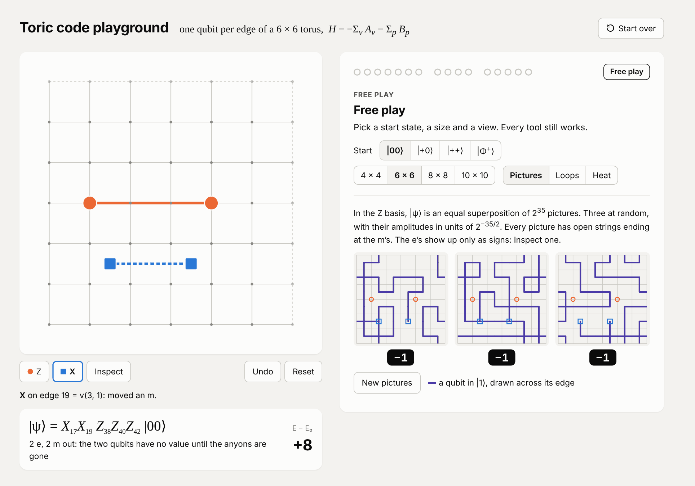

# toric-code-playground

[](https://liukelyu.github.io/toric-code-playground/)

*Why I built this.* Topological order, anyons, braiding: I have learned these words many times, but they never truely clicked, I did not have enough intuition for them. I built this mini project to get that intuition myself, by applying gates by hand and watching what they do to the state.

The toric code from scratch, on an $L \times L$ torus with one qubit per edge, $H = -\sum_v A_v - \sum_p B_p$ with $A_v = \prod_{e \ni v} X_e$ and $B_p = \prod_{e \in p} Z_e$. Every state is tracked exactly as a Pauli string acting on a ground state, and checked against brute-force 18-qubit state vectors and the exact Gibbs state.

**[Play in your browser](https://liukelyu.github.io/toric-code-playground/)**: nothing to install. Click an edge to apply a gate and watch the anyons, the energy and the two stored qubits change. Guided missions walk through the physics: the ground state as a loop soup, e and m anyons, braiding, logical gates, and a heat bath with a decoder. The same page works offline: open [`app/toric_code_playground.html`](app/toric_code_playground.html).

**Quick start in Python.**

```python
import toric

s = toric.new_state(6)                 # 6 x 6 torus in a ground state, E = -72
s.apply("Z", s.torus.h(2, 2))          # one Z on one edge
s.anyons(), s.energy()                 # -> ([(2, 2), (3, 2)], []), -68: two e anyons, +4

s = toric.new_state(6)
s.apply_string("X", s.torus.x_col(2))  # drag an m anyon around the torus
s.energy(), s.logical()                # -> -72, |10>: same energy, a different ground state (a stored bit)
```

Heat scrambles information. Errors from a bath at $T = 0.6$ scramble that stored bit after about 20 sweeps on a $6 \times 6$ torus (`toric.memory_lifetime(6, 0.6, None, 2000, np.random.default_rng())`), and a bigger torus does not help. Only frequent error correction does: decoding after every sweep keeps it for about 200 sweeps, and the gain grows with $L$.

How the Python package computes all this: the [tour notebook](examples/tour.ipynb). A state is printed as its two strings and its phase, and the notebook shows each step as counting bits: anyons are string ends, logical gates are strings that wind around the torus, braiding is a sign in the phase, and heat and decoding add more bits to the strings.

## What you will see

* An e anyon is a sign: two configurations that differ by flipping one star have amplitudes of opposite sign exactly at the e (checked on the 18-qubit state vector). An m anyon is the end of an open loop, visible in every configuration.
* Taking an e around an m and annihilating everything returns the start state times exactly $-1$.
* In equilibrium the fraction of stabilizers at $-1$ follows the Gibbs value $1/(1 + e^{2/T})$ to within 0.003 for $T = 0.5$ to $3$ ($L = 10$).
* A lone pair at $T \to 0$ ($L = 20$): 19% annihilate within one sweep, yet 60% drift $L/2$ apart at some point, because nothing pulls them back.
* Memory lifetime at $T = 0.6$ (mean of 200 runs): without correction 11 to 35 sweeps for every $L$ from 4 to 14; decoding after every sweep, 127 sweeps at $L = 4$ and over 6500 at $L = 14$. Decoding only every 10 sweeps lasts about 20 sweeps, no better than not decoding at all.

## Install

```bash
pip install -e ".[dev,examples]"
pytest
```

Each notebook cell runs in seconds. Results that need longer runs appear twice: a small live run you can change, then the full run loaded from a small file in `results/`. `python scripts/make_results.py` remakes those files (about 5 minutes on 4 cores). `tests/test_app.py` checks the app's JavaScript model against the Python package (it needs Node.js and is skipped without it).

Conventions: edge $h(i, j) = 2(jL + i)$ joins vertex $(i, j)$ to $(i+1, j)$ and $v(i, j) = h(i, j) + 1$ joins it to $(i, j+1)$; a state is $i^k X^a Z^b |\text{start}\rangle$; the logical basis is $|q_1 q_2\rangle$ with index $2q_1 + q_2$, read by the $Z$ loops along $x$ ($q_1$) and $y$ ($q_2$).

## References

* A. Yu. Kitaev, *Fault-tolerant quantum computation by anyons*, [arXiv:quant-ph/9707021](https://arxiv.org/abs/quant-ph/9707021); [Ann. Phys. 303, 2 (2003)](https://doi.org/10.1016/S0003-4916(02)00018-0)
* E. Dennis, A. Kitaev, A. Landahl, J. Preskill, *Topological quantum memory*, [arXiv:quant-ph/0110143](https://arxiv.org/abs/quant-ph/0110143); [J. Math. Phys. 43, 4452 (2002)](https://doi.org/10.1063/1.1499754)
* C. Nayak, S. H. Simon, A. Stern, M. Freedman, S. Das Sarma, *Non-Abelian anyons and topological quantum computation*, [arXiv:0707.1889](https://arxiv.org/abs/0707.1889); [Rev. Mod. Phys. 80, 1083 (2008)](https://doi.org/10.1103/RevModPhys.80.1083)
* R. Alicki, M. Horodecki, P. Horodecki, R. Horodecki, *On thermal stability of topological qubit in Kitaev's 4D model*, [arXiv:0811.0033](https://arxiv.org/abs/0811.0033); [Open Syst. Inf. Dyn. 17, 1 (2010)](https://doi.org/10.1142/S1230161210000023)

If this project helped you, you can [sponsor me on GitHub](https://github.com/sponsors/liukeLyu) or on [爱发电 Afdian](https://afdian.com/a/liukelyu) ♥
